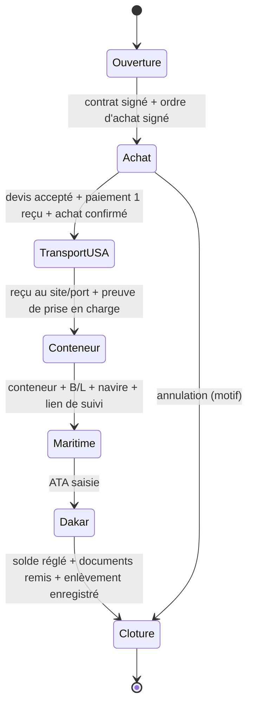

# Workflow du dossier : étapes, statuts et conditions de passage

Source : cahier des charges v1.1, annexe A ; contrat révisé. Une étape contient plusieurs statuts. Le passage d’une étape à la suivante vérifie les conditions ci-dessous ; une exception n’est possible que pour l’administrateur, avec motif journalisé.

| Étape | Statuts | Conditions pour passer à l’étape suivante |
|---|---|---|
| Ouverture | Nouveau ; informations à compléter ; contrat signé ; ordre d’achat signé ; validation requise | Client complet (pièce, coordonnées de notification) ; contrat du véhicule accepté (un contrat par véhicule, décision B1 ; méthodes R15) ; ordre d’achat signé avec enchère max et contrôle d’âge OK |
| Achat | Enchère en cours ; gagné ; devis émis ; devis validé ; paiement 1 attendu ; confirmé ; annulé | Lot gagné (prix ≤ enchère max ou validation admin) ; VIN 17 caractères ; devis accepté ; paiement 1 intégralement reçu ; facture d’enchère archivée |
| Transport USA | Enlèvement à planifier ; enlevé ; en transit ; reçu au site/port | Statut « reçu au site/port » ; preuve de prise en charge archivée |
| Conteneur | Chargement planifié ; chargé ; conteneur confirmé ; documents attendus | Véhicule associé à un conteneur ; transporteur, B/L, navire, voyage saisis ; lien de suivi disponible ; facture de solde émise (choix d’assurance enregistré) |
| Maritime | Réservation confirmée ; départ prévu ; en transit ; transbordement ; arrivée estimée ; arrivé | ATA saisie sur le conteneur |
| Dakar | Documents à finaliser ; solde attendu ; documents remis ; dédouanement en cours ; enlevé | Solde = 0 ; décharge de remise archivée ; enlèvement enregistré |
| Clôture | Terminé ; archivé ; réclamation ; litige ; suspendu ; non réclamé (procédure en cours) | — |

Règles complémentaires :
- Les statuts d’un même conteneur (départ, transbordement, arrivée) se propagent aux dossiers associés au statut correspondant de l’étape Maritime, sans changer d’étape automatiquement.
- Chaque changement d’étape ou de statut ajoute un événement à la chronologie du dossier et une ligne d’audit.
- Notifications client déclenchées : lot remporté, devis émis, échéances, départ du navire, ETA modifiée, arrivée, documents prêts, relances (voir `15_user_stories.md`, phase 4).
